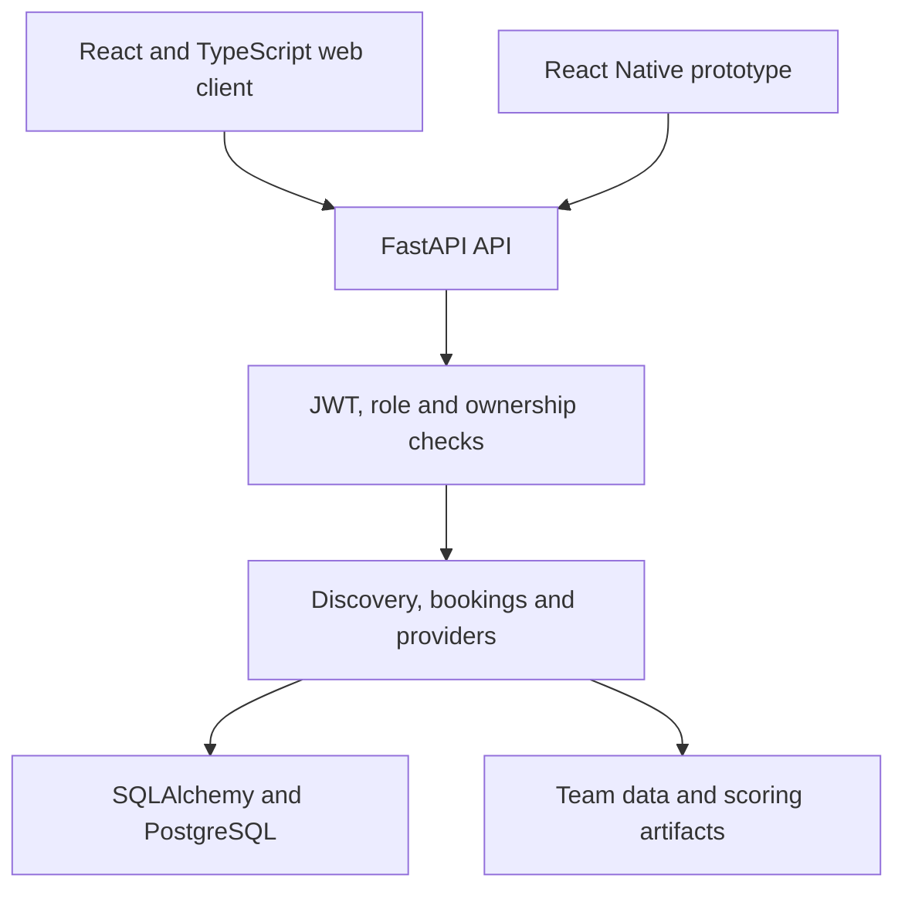

# Plug & Wifi — my backend contribution

**Team research-practicum project: discover work-friendly venues and connect discovery, availability, bookings, and provider workflows.**

[Public team repository](https://github.com/Research-Practicum-Group-4/plugandwifi) · [Run the refresh-session example](examples/) · [Measurement scope](results/README.md)

## Problem and purpose

Remote workers and students need more than a venue's location: Wi-Fi, access to power, price, availability, and suitability affect whether a place works for a particular visit. Providers also need a controlled way to list spaces and manage bookings. Plug & Wifi connects these needs in a shared web/backend workflow.

This is an academic team project. I contributed backend and integration work; the complete product, interfaces, and data/ML work were team efforts. The repository documents a mock payment flow, not real payment processing. Current public hosting is not verified here; the source README's hosting-validity date has passed.

## My contribution, with reviewable evidence

The linked pull requests were authored by `sunminlee-ucd` and merged into the team repository. They provide a more precise contribution record than claiming ownership of the whole application.

| Area | My implementation | Evidence |
| --- | --- | --- |
| Session lifecycle | Hashed refresh tokens, rotation, fixed absolute expiry, token-family revocation on reuse, and logout revocation | [PR #56](https://github.com/Research-Practicum-Group-4/plugandwifi/pull/56) |
| Authorization | Reusable role checks that compare the token role with the current database role | [PR #59](https://github.com/Research-Practicum-Group-4/plugandwifi/pull/59) |
| Booking ownership | Derive the booking's user from authentication instead of accepting a client-supplied user ID | [PR #78](https://github.com/Research-Practicum-Group-4/plugandwifi/pull/78) |
| Search integration | Implement advanced venue filters and connect the web/mobile clients to a shared API contract | [PR #99](https://github.com/Research-Practicum-Group-4/plugandwifi/pull/99) |
| Checkout states | Pending-payment bookings and explicit successful/failed mock confirmation paths | [PR #101](https://github.com/Research-Practicum-Group-4/plugandwifi/pull/101) |

## Engineering choices

**Keep sessions renewable without storing raw refresh tokens.** The application returns an opaque token to the client and persists its SHA-256 hash. Rotation revokes the previous session and links its replacement, retaining the family's original expiry. Reuse of an already-revoked token revokes active descendants in that family.

**Use current server-side identity for authorization.** The role dependency rejects missing or stale token roles. Booking creation uses the authenticated user, while provider and customer operations also need resource-ownership checks. A token's existence alone is not sufficient authorization.

**Make integration contracts explicit.** Search filters have consistent API semantics across web and mobile. The checkout workflow distinguishes pending, paid, and failed states, allowing the team to demonstrate the flow with a mock confirmation endpoint.

## Architecture and stack

The team repository also contains pytest tests, web/mobile tooling, and Dockerfiles. The mobile client and data/ML paths include prototype and integration work; this case study does not present every platform as equally complete.

## Runnable backend mechanism

The [standalone refresh-session example](examples/) adapts the reviewed lifecycle to Python's standard library and SQLite. It demonstrates persistent revocation, fixed expiry, transaction rollback, and concurrent refresh handling without a cloud account or API credentials.

**11 focused tests pass locally.** They validate this adaptation, including two connections attempting to use the same token. They do not rerun the team's complete test suite or establish production authentication security. Historic test counts in the linked PRs belong to those PRs' original validation reports.

The [recorded measurement](results/README.md) includes its command, environment, raw samples, and explicit limits. It measures the local SQLite adaptation, not PostgreSQL or end-to-end API performance.

## Source provenance and scope

Reviewed team commit: [`64eacd4`](https://github.com/Research-Practicum-Group-4/plugandwifi/tree/64eacd4bf566b9e9f5c5c552b4d6f0e3ace36cdf), 19 October 2026. Relevant implementation: [refresh helpers](https://github.com/Research-Practicum-Group-4/plugandwifi/blob/64eacd4bf566b9e9f5c5c552b4d6f0e3ace36cdf/backend/app/refresh_tokens.py), [role checks](https://github.com/Research-Practicum-Group-4/plugandwifi/blob/64eacd4bf566b9e9f5c5c552b4d6f0e3ace36cdf/backend/app/rbac.py), and [authentication/booking endpoints](https://github.com/Research-Practicum-Group-4/plugandwifi/blob/64eacd4bf566b9e9f5c5c552b4d6f0e3ace36cdf/backend/app/main.py).

This personal case study adds explanation and a focused adaptation. The original team repository remains the source of truth for the complete project.
